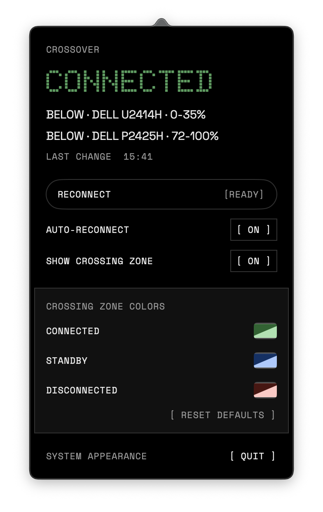
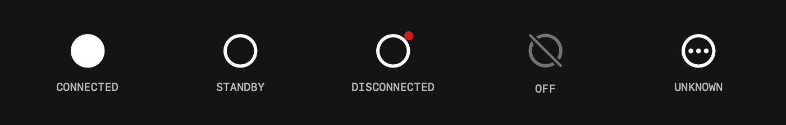
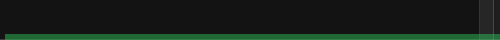

# Crossover

Crossover는 Universal Control(Mac과 iPad 사이의 포인터 공유)의 연결 상태와 포인터가 화면을 넘나드는 위치를 표시하고, 연결이 끊기면 자동으로 다시 연결하는 macOS 메뉴 막대 앱입니다.



## Universal Control이 불편한 이유

- macOS에는 현재 iPad가 연결됐는지 보여주는 상태 표시가 없습니다. 포인터를 iPad 쪽으로 직접 밀어 봐야 연결 여부를 알 수 있습니다.
- 연결이 끊기거나 다시 연결돼도 알림이 없습니다. 내부 연결이 짧은 간격으로 반복해 끊기는 동작이 보이며, 이 프로젝트 로그에는 끊긴 뒤 16초 만에 다시 연결된 사례가 있습니다.
- 포인터가 어느 화면 가장자리로 넘어가는지와 그 범위는 **시스템 설정 > 디스플레이 > 정렬**에서만 확인할 수 있습니다. 여러 모니터가 iPad 가장자리에 닿으면 둘 이상의 화면에 걸쳐 연결 구간이 생깁니다. 이전에 확인한 배치에서는 U2414H 하단 0–51%와 P2425H 하단 88–100%가 사용됐습니다. 구간은 디스플레이 배치에 따라 달라집니다.
- 연결 중인지, 포인터를 움직이지 않아 대기 상태인지 알 수 없습니다. 로그에서는 유휴 시간 초과 후 연결이 대기 상태로 바뀌고 포인터를 밀면 다시 활성화되는 동작이 확인됐습니다.
- 연결이 멈추면 기본 설정에서는 Universal Control을 껐다 켜거나 Mac을 재시동해야 복구할 수 있습니다. `UniversalControl` 프로세스는 SIGTERM을 무시하므로 Crossover는 프로세스를 강제 종료해 복구를 요청합니다.
- iPad 제어 센터에서 Wi‑Fi를 꺼도 연결이 끊기지 않을 수 있습니다. Bluetooth와 피어 투 피어 Wi‑Fi를 함께 사용하기 때문에 현재 연결 상태를 설정만 보고 판단하기 어렵습니다.

## 기능

- 포인터가 넘어가는 화면 가장자리에 연결 구간을 표시합니다. 연결, 대기, 연결 끊김 상태별 색상을 설정할 수 있습니다.
- 메뉴 막대 아이콘으로 연결 상태를 구분합니다. 채운 원은 연결, 테두리 원은 대기, 빨간 점은 연결 끊김, 흐린 빗금 원은 꺼짐, 점 세 개가 든 원은 알 수 없는 상태입니다.

  

- Nothing 스타일 팝오버에서 상태, 화면별 연결 위치, 마지막 변경 시각을 확인하고 자동 재연결과 crossing zone 표시 및 색상을 설정할 수 있습니다.
- 연결 끊김, 꺼짐, 재연결 및 자동 재연결 실패 알림을 표시합니다. 알림은 macOS 알림 권한이 필요합니다.
- 자동 재연결은 15초, 30초, 60초 간격으로 최대 세 번 시도합니다. 자동 재연결이 꺼져 있거나 Universal Control의 설정 기기 목록이 비어 있으면 시도하지 않습니다. 수동 재연결도 지원합니다.
- 시작할 때 최근 시스템 로그를 읽어 마지막 연결 상태와 화면 배치를 복구합니다.

  

## 동작 방식

Crossover는 macOS 통합 로그에서 `com.apple.universalcontrol` 하위 시스템을 `log stream`으로 읽습니다. 로그를 읽기 위한 추가 권한은 필요하지 않습니다.

| 로그 신호 | 용도 |
| --- | --- |
| `CONN`의 `Connected` / `Disconnected` | 연결 상태와 연결 변경 알림 |
| `Configured Devices` | 연결된 기기 목록의 비어 있음 여부 |
| `displayLayout` | Mac과 iPad 화면의 위치 및 겹치는 가장자리 계산 |
| `config` | iPad와 연결된 화면 가장자리 정보 보완 |

재연결할 때 Crossover는 `killall -KILL UniversalControl`을 실행합니다. macOS가 해당 프로세스를 다시 시작하며, 이 프로젝트에서는 약 2초 안에 재시작되는 것을 확인했습니다.

## 설치 및 빌드

최신 DMG 또는 PKG는 [GitHub Releases](https://github.com/BertiKarsunke/crossover/releases)에서 받을 수 있습니다. 직접 빌드하려면 macOS와 Xcode Command Line Tools가 필요합니다.

```sh
./build-app.sh
./package.sh
```

앱은 `.build/Crossover.app`에 생성됩니다. 패키징하면 `dist/Crossover-<version>.dmg`와 `dist/Crossover-<version>.pkg`가 만들어집니다. 기본 서명은 ad-hoc입니다. 다른 Mac에서 처음 실행할 때는 앱을 우클릭하고 **열기**를 선택해야 할 수 있습니다.

서명 인증서를 지정하려면 환경 변수를 설정합니다.

```sh
SIGN_ID="Developer ID Application: ..." SIGN_INSTALLER_ID="Developer ID Installer: ..." ./package.sh
```

첫 실행 때 알림 권한 요청이 나타납니다. 알림을 받으려면 허용하세요.

## 제한 사항

- Crossover는 공개 API가 아닌 Apple 내부 로그 메시지에 의존합니다. macOS 업데이트 후 메시지 형식이 바뀌면 동작하지 않을 수 있습니다. macOS 26.6.2에서 확인했습니다.
- `Configured Devices []`는 설정에서 Universal Control을 껐을 때 외의 상황에서도 나타날 수 있으므로, 이 값만으로 사용자가 기능을 껐다고 단정할 수 없습니다.
- 가장자리 방향과 연결 구간 해석은 관찰한 로그와 화면 배치 동작을 바탕으로 합니다. 실제 구간은 모니터 배치에 따라 달라집니다.

## 라이선스

코드는 MIT License이며, 포함된 Space Grotesk, Space Mono, Doto 글꼴은 SIL Open Font License를 따릅니다. 글꼴은 [google/fonts](https://github.com/google/fonts)에서 가져왔습니다. 자세한 내용은 [LICENSE](LICENSE)와 글꼴별 OFL 파일을 확인하세요.
